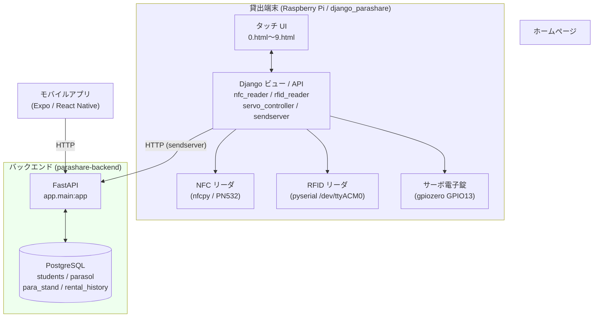
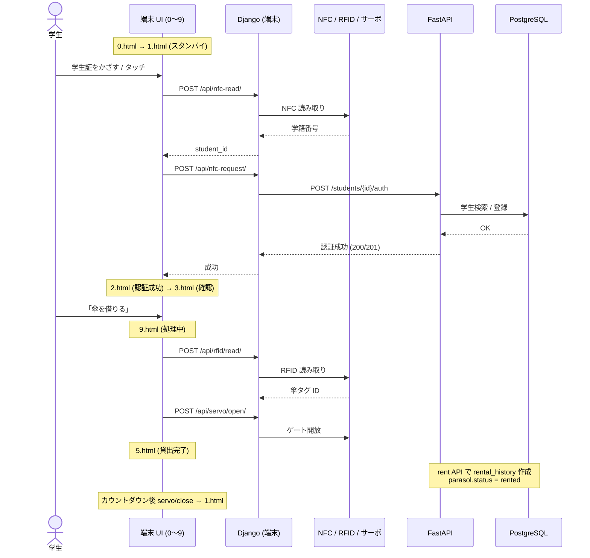

# システム構成 — Parashare

Parashare は **貸出端末（Raspberry Pi）**、**バックエンド API（FastAPI）**、**データベース（PostgreSQL）**、**モバイルアプリ** から構成されます。傘の貸出・返却は、端末上の NFC / RFID 読み取りとサーボ電子錠、バックエンド API による履歴記録の連携で自動化されます。

## 全体構成図

- 端末の Django アプリは、ブラウザ（タッチ UI）からのリクエストを受けて、ローカルのハードウェア（NFC / RFID / サーボ）を制御します。
- 端末はバックエンド API へ HTTP リクエストを送り（`sendserver.py`）、学生認証・貸出・返却を記録します。
  - 接続先: `http://api.chukyo-parashare.com:8000`
- モバイルアプリは同じ API を利用して、利用状況やスタンド情報を取得します。

## コンポーネントの役割

### 貸出端末（django_parashare）

| ファイル | 役割 |
|---------|------|
| `views.py` | 画面 `0`〜`9` を返す（各 `page0`〜`page9`） |
| `nfc_reader.py` | `POST /api/nfc-read/`。NFC タグを読み取り学籍番号を抽出 |
| `sendserver.py` | `POST /api/nfc-request/`。学籍番号をバックエンドの `/students/{id}/auth` へ中継 |
| `rfid_reader.py` | `POST /api/rfid/read/`、`GET /api/rfid/status/`。傘 RFID タグを複数回読み取り、最多検出 ID を返す |
| `servo_controller_simple.py` | `POST /api/servo/open/`・`/close/`、`GET /api/servo/status/`。サーボ電子錠の開閉 |

> NFC 読み取りは `[A-Za-z]?\d{6,10}` の正規表現で学籍番号を抽出します。
> RFID は 3 回読み取り、最も多く検出されたタグ ID を採用します（ノイズ対策）。

### バックエンド API（FastAPI / routes/device.py）

| メソッド・パス | 役割 |
|---------------|------|
| `POST /students/{student_id}/auth` | 学生の認証。未登録なら新規登録（201）、登録済みなら認証成功（200） |
| `POST /students/{student_id}` | 学生が次に「貸出可（`rent`）」か「返却可（`return`）」かを判定 |
| `GET /stands/list` | 全スタンドの一覧と在庫数 |
| `POST /parasols/{rfid}/rent` | 傘の貸出。`rental_history` を作成し、傘を `rented` に更新。返却期限は **2日後** |
| `POST /parasols/{rfid}/return` | 傘の返却。`rental_history.returned_at` を記録し、傘を `available` に戻す |

### データベース（PostgreSQL）

| テーブル | 主な役割 |
|---------|---------|
| `students` | 学生（`student_id` = 学籍番号、UUID 主キー） |
| `parasol` | 傘（`rfid_id`、`status` = available / rented / maintenance / lost） |
| `para_stand` | 傘スタンド（`location`、`version`） |
| `rental_history` | 貸出履歴（貸出元 / 返却先スタンド、`rented_at` / `due_at` / `returned_at`） |

詳細なスキーマは [data-model.md](data-model.md) を参照してください。

## 貸出フロー（学生が傘を借りる）

> 注: 現行の端末テンプレートでは、認証成功後に画面 `9` で RFID 読み取り → ゲート開放 → 画面 `5`（貸出完了）へ遷移します。バックエンドの `rent` / `return` API は端末・モバイル双方から呼び出される想定です。画面 `4`（ポイント不足）・`6`（傘不足）・`7`（返却完了）は設計済みですが、現行テンプレートの遷移には組み込まれていません。

## 返却フロー（学生が傘を返す）

返却はバックエンドの `POST /parasols/{rfid}/return` で処理されます。

1. 傘の RFID から `parasol` を特定。
2. その学生が借りている未返却の `rental_history`（`returned_at IS NULL`）を検索。
3. `returned_at` と返却先スタンド（`return_stand_to`）を記録し、`parasol.status` を `available` に戻す。

返却可否（`rent` / `return`）の判定は `POST /students/{student_id}` で、最新の貸出履歴の `returned_at` の有無により行われます。

## 関連ドキュメント

- [overview.md](overview.md) — プロジェクト概要・技術スタック
- [state-transitions.md](state-transitions.md) — 状態遷移の詳細（メインドキュメント）
</content>
