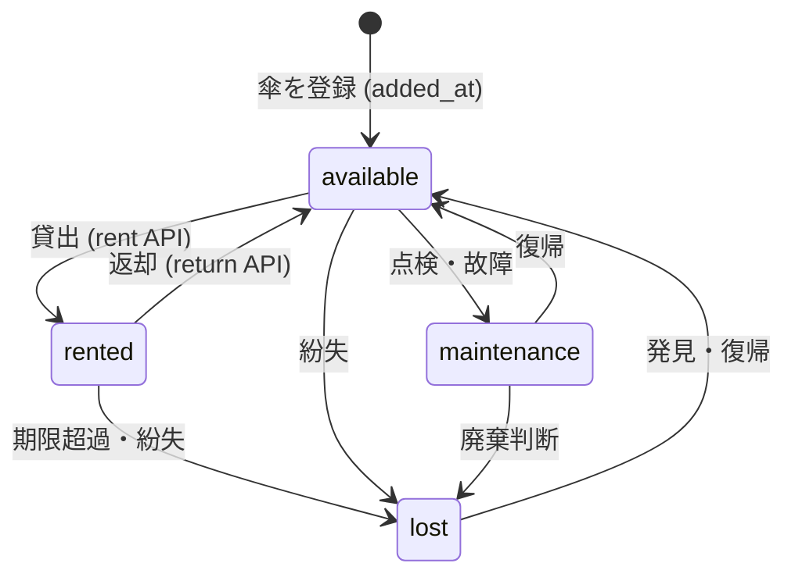
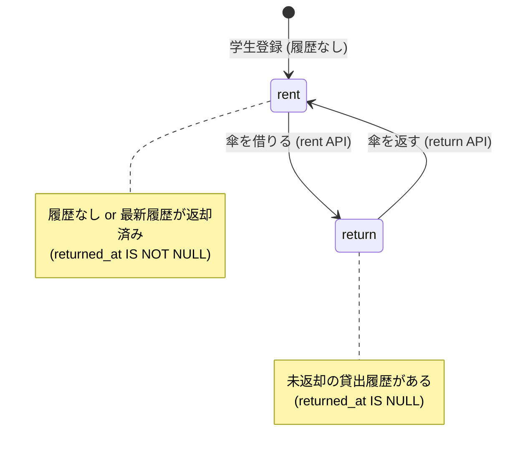
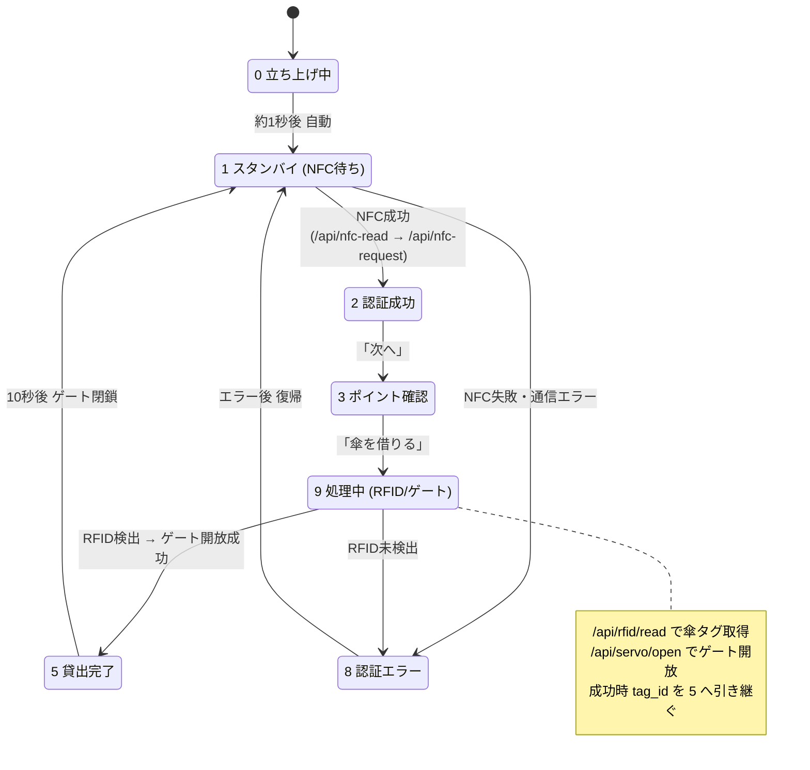
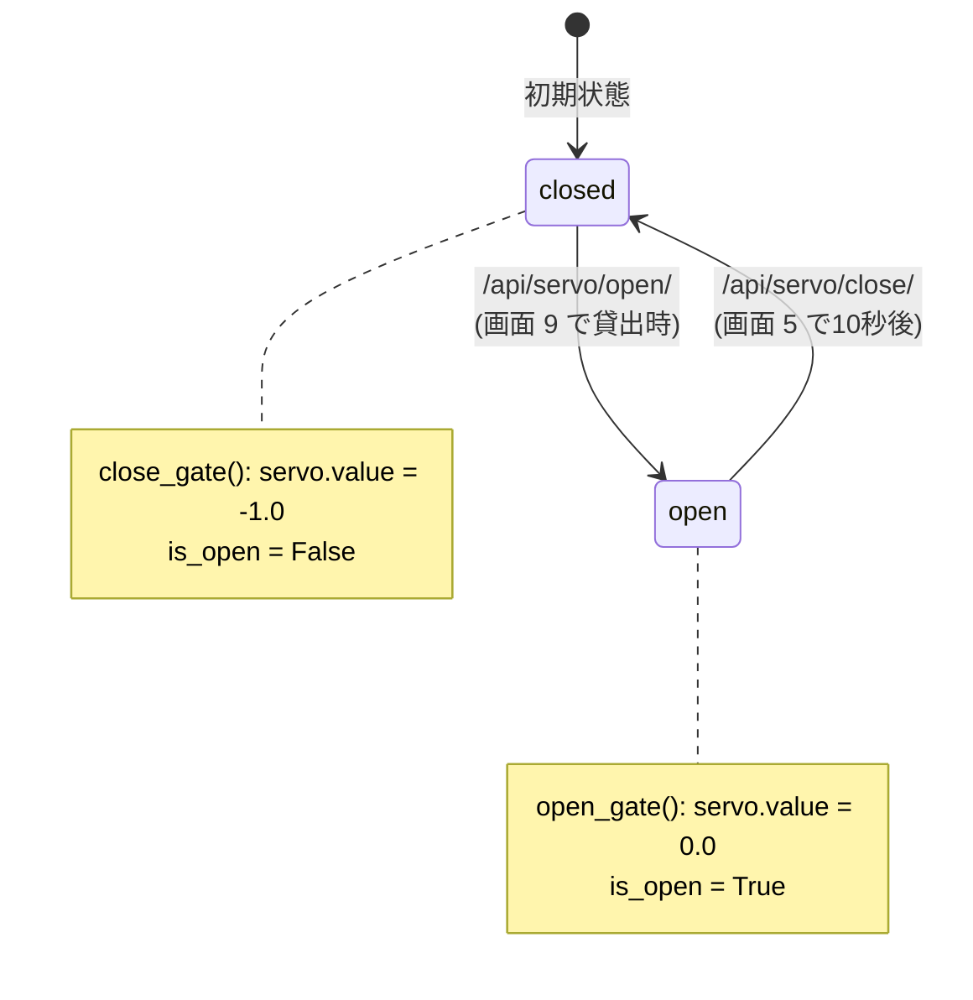
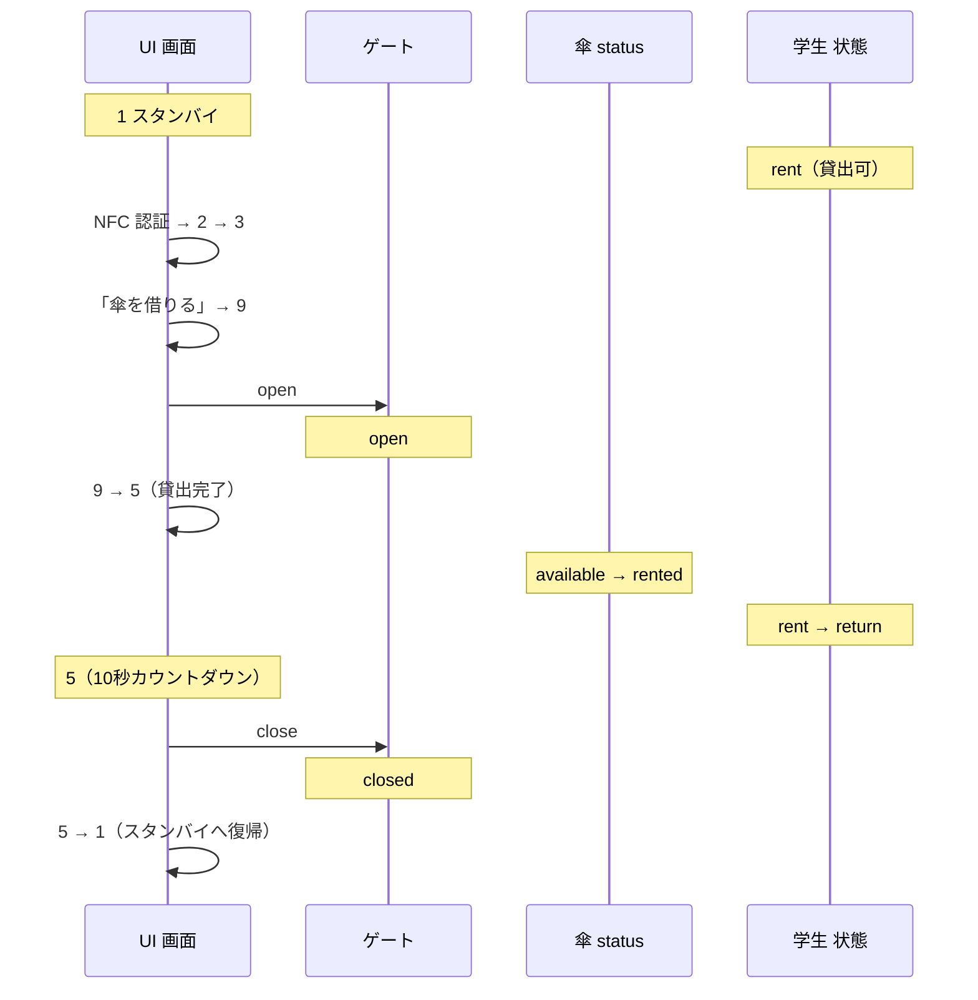

# 状態遷移 — Parashare（メインドキュメント）

Parashare には大きく **4種類の状態** が存在します。本ドキュメントでは、それぞれの状態と遷移条件を、コードベースの事実に基づいて整理します。

| # | 状態の種類 | 状態の値 | 管理場所 |
|---|-----------|---------|---------|
| 1 | 傘の状態 | `available` / `rented` / `maintenance` / `lost` | DB `parasol.status` |
| 2 | 学生の貸出状態 | `rent` / `return` | `rental_history.returned_at` から動的判定 |
| 3 | 端末 UI 画面 | `0.html`〜`9.html`（10画面） | 端末 Django テンプレート |
| 4 | ゲート（電子錠） | `open` / `closed` | サーボモーター（`servo_controller`） |

---

## 1. 傘の状態（parasol.status）

傘 1本ごとに、PostgreSQL の `parasol.status`（ENUM `parasol_status`）で状態を保持します。

### 状態の意味

| 状態 | 意味 |
|------|------|
| `available` | 貸出可能。スタンドに設置され、誰にも借りられていない。 |
| `rented` | 貸出中。ある学生が借りており未返却。 |
| `maintenance` | メンテナンス中。貸出対象外。 |
| `lost` | 紛失。貸出対象外。 |

### 状態遷移図



### 遷移の根拠（コード）

- `available → rented`：`POST /parasols/{rfid}/rent`
  - 対象は `status == available` の傘のみ（`device.py`）。貸出時に `parasol.status = rented` をセットし、`rental_history` を作成。
- `rented → available`：`POST /parasols/{rfid}/return`
  - 返却時に `parasol.status = available` に戻し、`parasol.updated_at` を更新。
- `maintenance` / `lost`：ENUM・DDL（`database.sql`）に定義されている運用状態。現行 API には自動遷移処理はなく、管理操作で設定する想定です。

---

## 2. 学生の貸出状態（rent / return）

学生ごとの「次にできる操作」を表す状態です。テーブルには保存されず、`rental_history` から **動的に判定** されます（`POST /students/{student_id}`）。

| 状態 | 意味 | 判定条件 |
|------|------|---------|
| `rent` | 貸出可（傘を借りられる） | 履歴なし、または最新履歴が **返却済み**（`returned_at IS NOT NULL`） |
| `return` | 返却可（傘を返す必要がある） | 最新履歴が **未返却**（`returned_at IS NULL`） |

### 判定ロジック（device.py）

```text
最新の rental_history を rented_at の降順で1件取得
  latest が None、または latest.returned_at が NULL でない  → "rent"
  それ以外（未返却の傘がある）                              → "return"
```

### 状態遷移図



> この状態は「1人 1本まで」を前提としたモデルです。借りている間は `return` 状態となり、新たな貸出はできません。

---

## 3. 端末 UI 画面の状態（0.html〜9.html）

貸出端末のタッチ UI は 10 枚の HTML 画面（`django_parashare/templates/`）を、ブラウザの JavaScript による `window.location.href` 遷移で切り替えます。

### 各画面の役割

| 画面 | タイトル | 役割 |
|------|---------|------|
| `0` | 立ち上げ中 | 起動画面。約1秒後に `1` へ自動遷移。 |
| `1` | スタンバイ | 学生証タッチ待ち。NFC 読み取り → 認証。 |
| `2` | 認証成功 | 学籍番号を表示。「次へ」で `3` へ。 |
| `3` | ポイント確認 | 「傘を借りる」で `9` へ。 |
| `4` | ポイント不足 | エラー表示。`1` へ戻る（※現行遷移では未到達）。 |
| `5` | 貸出完了 | 10秒カウントダウン後にゲートを閉じ `1` へ。 |
| `6` | 傘不足 | エラー表示。`1` へ戻る（※現行遷移では未到達）。 |
| `7` | 返却完了 | 完了表示。`1` へ戻る（※現行遷移では未到達）。 |
| `8` | 認証エラー | NFC / RFID 失敗時。`1` へ戻る。 |
| `9` | システム処理中 | RFID 読み取り → ゲート開放。成功で `5`、失敗で `8`。 |

### 画面遷移図



> 画面 `4`（ポイント不足）・`6`（傘不足）・`7`（返却完了）はテンプレートとして用意されていますが、現行のクライアント遷移ロジックには接続されていません。今後の貸出可否判定（ポイント・在庫）や返却フローの UI として組み込む想定です。

### 遷移の根拠（テンプレート JS）

- `0 → 1`：`0.html` の `setTimeout` で `/1/` へ。
- `1 → 2 / 8`：`1.html` が `/api/nfc-read/` で学籍番号取得 → `/api/nfc-request/` で認証中継。成功で `/2/?studentID=...`、失敗・例外で `/8/`。
- `2 → 3`：`2.html` の「次へ」。
- `3 → 9`：`3.html` の「傘を借りる」。
- `9 → 5 / 8`：`9.html` が `/api/rfid/read/` で傘タグ取得後、`/api/servo/open/` でゲート開放。RFID 検出時は `/5/?tag_id=...`、未検出時は `/8/`。
- `5 → 1`：`5.html` が10秒カウントダウン後に `/api/servo/close/` を呼び `/1/` へ。
- `8 → 1`：`8.html` から `/1/` へ復帰。

---

## 4. ゲート（電子錠）の状態（open / closed）

傘を取り出す物理ゲートは、Raspberry Pi の GPIO13 に接続したサーボモーターで開閉します（`servo_controller_simple.py`）。状態は `ServoController.is_open` で保持されます。

| 状態 | サーボ値 | 意味 |
|------|---------|------|
| `closed` | `value = -1.0` | 施錠。通常時。 |
| `open` | `value = 0.0` | 開放。傘の取り出しが可能。 |

### 状態遷移図



### 遷移の根拠（コード）

- `closed → open`：`open_gate_api`（`POST /api/servo/open/`）。画面 `9` の RFID 検出後に呼ばれる。
- `open → closed`：`close_gate_api`（`POST /api/servo/close/`）。画面 `5` のカウントダウン終了時に呼ばれる。
- `GET /api/servo/status/`：現在の `is_open` 等を取得。
- Raspberry Pi 以外の環境（`gpiozero` 不在）では **シミュレーションモード** で動作し、ハードウェアなしで状態のみ遷移します。

---

## 4状態の連動（貸出シナリオ全体）

正常な貸出 1回における、4状態の連動を示します。



返却時は逆に、`parasol.status` が `rented → available`、学生状態が `return → rent` に戻り、`rental_history.returned_at` が記録されます。

## 関連ドキュメント

- [overview.md](overview.md) — プロジェクト概要・技術スタック
- [architecture.md](architecture.md) — システム全体構成と処理フロー
</content>
